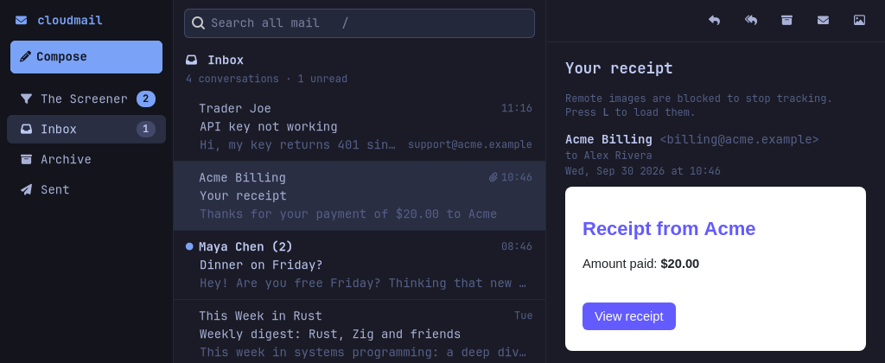
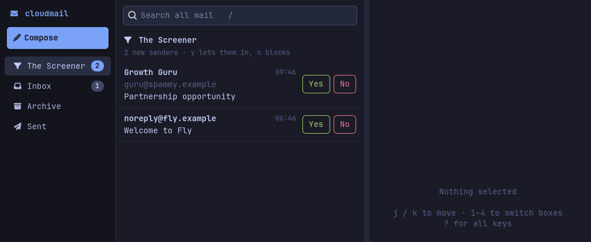

# Cloudmail

Email for people and organizations on their own domains, run entirely from their own Cloudflare
account, with Gmail, iCloud Mail and HEY in the same app. It has a HEY-style **Screener**, a fast
native Linux app, and a CLI that AI agents can drive without any special setup.

**Screened email · native Linux app · agent-friendly CLI · no mail server.**

<sub>Not affiliated with [maillab/cloud-mail](https://github.com/maillab/cloud-mail) ("Cloud Mail")
or [CloudMailin](https://www.cloudmailin.com). Different projects that happen to have similar names.</sub>

<p align="center">
  
  
</p>

<p align="center">
  
</p>

## Who it's for

- You own a domain whose DNS is on Cloudflare, and you want its mail out of Google Workspace,
  Fastmail and the like, without running Postfix on a server.
- You're on Omarchy or another Arch Linux desktop and want a keyboard-first mail app that
  follows your theme. The CLI runs on other Linux systems too.
- You want an inbox your scripts or your local AI agent can read and answer through a plain
  CLI, without a Gmail API project.
- You just want a keyboard-first Linux app and CLI for your Gmail, iCloud Mail or HEY. Link them
  and go; no domain or Cloudflare account needed ([more](#your-hey-gmail-and-icloud-mail-too-optional)).
- You like HEY's Screener and want it on your own domain, in your own account.
- Someone close to you, like a partner or a colleague, wants the same for their domains. You run it
  and invite them; they install the app and connect with a link, with no Cloudflare account of
  their own.

## How it works

```
sender ─SMTP─▶ Email Routing ─▶ Worker email() ─▶ D1 (threads, messages, search) + R2 (raw mail, attachments)
cloudmail / cloudmail-gtk ─HTTPS + token─▶ Worker /api/* ─▶ Email Service (outgoing mail)
```

- **Receive** with Cloudflare Email Routing, **send** with Cloudflare Email Service. No mail server,
  no IMAP, nothing to patch.
- **Your data stays in your account**: messages in D1 (with full-text search), raw `.eml` files and
  attachments in R2. Nothing goes through a service I run.
- **The Screener**: the first email from someone new waits for a yes or no. Yes, and their mail goes
  to your Inbox from then on. No, and you never hear from them again. People you email are screened
  in automatically. If the sender's domain didn't authenticate a message (DMARC, or aligned
  DKIM/SPF when the domain has no DMARC policy), that message can't ride on an earlier approval.
  More: [docs/screening.md](docs/screening.md).
- **Several domains, one inbox.** Personal addresses are screened. Role addresses like `support@`
  deliver straight to the Inbox. Replies go out from the address the mail was sent to.
- **Inbox and Archive**, that's it. A reply on an archived thread brings it back. Delete removes a
  thread (for a linked account, it goes to that account's Trash).
- **Privacy by default**: remote images and tracking pixels stay blocked until you ask for them.
- **One admin, a few people.** Whoever deploys it is the admin and can invite others to read their
  own mail on it; each person sees only their own mailboxes, Screener and settings.

| Path | What |
|---|---|
| `worker/` | Cloudflare Worker (TypeScript): inbound handler, Screener, JSON API |
| `crates/cloudmail` | `cloudmail` CLI |
| `crates/cloudmail-gtk` | `cloudmail-gtk` desktop app (GTK4 + WebKitGTK), themed from Omarchy if present |
| `crates/cloudmail-api` | Rust API client shared by both, plus linked accounts (HEY through the `hey` CLI, Gmail through Google's `gws` CLI, iCloud Mail through icloud-session) |
| `docs/API.md` | HTTP API reference |

## What you need

To run it (the admin):

- A domain whose DNS is on Cloudflare.
- A Cloudflare account. Receiving works on the free plan. To send to anyone you need the Workers
  Paid plan (about $5/month, with 3,000 emails/month included).
- For the desktop app: Omarchy or another Arch Linux desktop (x86_64 and aarch64 packages), or
  GTK 4.16+ and WebKitGTK 6.0 if you build it yourself.
- A keyring (GNOME Keyring, KeePassXC or any other Secret Service): Cloudmail keeps its API token
  there and nowhere else. Omarchy and most Linux desktops have one.
- Node.js/npm on the machine where you run `cloudmail setup`. It deploys the worker with
  Cloudflare's `cf` CLI.

Invited to someone's? You only need the app (or just the CLI) and a keyring, then
[connect](#share-it-with-someone): no Cloudflare account, domain setup or Node.js.

Only want your Gmail, iCloud Mail or HEY? The app (or CLI) and a keyring, then
[link them](#your-hey-gmail-and-icloud-mail-too-optional); no worker at all.

## Install

**Omarchy or any Arch Linux (x86_64 and aarch64):**

```sh
curl -fsSL https://ferdousbhai.com/cloudmail/install.sh | sudo bash
```

This trusts Cloudmail's package-signing key (checked against the pinned fingerprint
`52130299581DAD685226900CA89CA1A6A1E74251`), adds the signed pacman repository for your
architecture (`[cloudmail]` on x86_64, `[cloudmail-aarch64]` on ARM), and installs `cloudmail` and
`npm`. On Omarchy it also adds a hook so the repository survives `omarchy refresh pacman`. Updates
arrive with `omarchy update` (or `pacman -Syu`). The script is
[`packaging/repo/install.sh`](packaging/repo/install.sh), if you'd rather read it first or do the
same steps by hand:

```sh
repo=cloudmail; [ "$(uname -m)" = aarch64 ] && repo=cloudmail-aarch64
release=https://github.com/ferdousbhai/cloud-mail/releases/latest/download
curl -fsSLO "$release/$repo-signing-key.asc"
gpg --show-keys "$repo-signing-key.asc"       # must show 52130299581DAD685226900CA89CA1A6A1E74251
sudo pacman-key --add "$repo-signing-key.asc"
sudo pacman-key --lsign-key 52130299581DAD685226900CA89CA1A6A1E74251
printf '[%s]\nSigLevel = Required DatabaseRequired\nServer = %s\n' "$repo" "$release" \
  | sudo tee "/etc/pacman.d/$repo.conf"
echo "Include = /etc/pacman.d/$repo.conf" | sudo tee -a /etc/pacman.conf
sudo pacman -Syu cloudmail npm                # on Omarchy: omarchy pkg add cloudmail npm
```

Cloudmail is also on its way into Omarchy's own repository and *Install › Service* menu
([omarchy-pkgs#724](https://github.com/omacom/omarchy-pkgs/pull/724),
[omarchy#13763](https://github.com/omacom/omarchy/pull/13763)). Until those are merged, use the
commands above.

**Just the CLI, on other Linux systems:** each release since v0.6.1 has prebuilt `cloudmail`
archives attached (x86_64 and aarch64, statically linked), with a `SHA256SUMS` file. Each archive
holds the `cloudmail` binary and the `worker/` source that `cloudmail setup` deploys. Put the
binary on your `PATH` and keep the unpacked folder: run `cloudmail setup` from inside it (it
deploys the `worker/` it finds there), or pass `--worker-dir path/to/worker`.

With Rust installed you can build the CLI instead. Run `cloudmail setup` from a clone, because
that's where `worker/` lives:

```sh
cargo install --locked --git https://github.com/ferdousbhai/cloud-mail cloudmail
```

### From source

You need Rust **1.89 or newer** for the CLI and **1.95 or newer** for the desktop app, plus
Node.js. The desktop app also needs GTK 4.16 or newer and WebKitGTK 6.0 (`./install.sh` installs
them on Arch; Debian 13: `apt install libgtk-4-dev libwebkitgtk-6.0-dev`).

```sh
git clone https://github.com/ferdousbhai/cloud-mail && cd cloud-mail
./install.sh                    # installs cloudmail (alias: cmail) + cloudmail-gtk to ~/.local/bin
# CLOUDMAIL_NO_GTK=1 ./install.sh   # CLI only
```

## Set it up

Setup is for the admin: the person whose Cloudflare account holds the domains. If someone invited
you, skip this section and run `cloudmail connect <the link they sent you>` instead
([more](#share-it-with-someone)); setup refuses to run for an invited user. If you only want
Gmail, iCloud Mail or HEY, skip it too and [link them](#your-hey-gmail-and-icloud-mail-too-optional).

```sh
cloudmail setup you@yourdomain.com
```

`setup` logs you in to Cloudflare in your browser, deploys your mail service to your account
(a Worker, a D1 database and an R2 bucket), turns on receiving and sending for your domain, and
connects the app, keeping its API token in your keyring (GNOME Keyring, or any Secret Service).
Open **Cloudmail** from the app launcher.

- Several addresses and domains: `cloudmail setup you@a.com support@a.com:direct hello@b.com`.
  `:direct` skips the Screener (good for `support@`, `legal@`, …).
- If a domain already receives mail somewhere else (Google Workspace, Fastmail, …), setup tells you
  where and asks before moving it, because that replaces the domain's MX records.
- `--forward-to me@gmail.com` keeps a copy of everything going to your old inbox while you switch.
  Cloudflare emails that address a link to confirm it. Turn it off later with
  `cloudmail settings set forward-to ""`.
- `--dry-run` shows every step first. Running setup again is safe, and is how you update the
  worker after an upgrade.
- Sending adds SPF/DKIM records and a `p=reject` DMARC record to the domain. If another service
  sends mail as that domain, set it up with SPF/DKIM first.

Add addresses later with `cloudmail mailbox add sales@yourdomain.com --route`.

**For agents and scripts**, setup never prompts when output is piped. Give it a Cloudflare API token
instead of the browser login, and `--yes` to allow moving a domain's mail:

```sh
CLOUDFLARE_API_TOKEN=… cloudmail setup you@yourdomain.com --yes
```

Create the token under *My Profile › API Tokens* with these permissions:
**Account**: Workers Scripts, D1, Workers R2 Storage, Email Routing Addresses and Email Sending (all
Edit), Account Settings (Read); **Zone** (your mail domains): Email Routing Rules, Zone Settings and
DNS (Edit), Zone (Read). If setup can't tell which account to use, add `--account <id>` (the Account
ID on your Cloudflare dashboard's home page).

## Use it

```sh
cloudmail-gtk                 # or "Cloudmail" in your app launcher
cloudmail                     # orientation and config status
cloudmail screener            # who's waiting
cloudmail screener approve alice@example.com
cloudmail inbox --unread
cloudmail thread read <id>
cloudmail reply <id> -m "Sounds good."
cloudmail compose --to a@example.com --subject Invoice -m "Attached." --attach invoice.pdf
cloudmail watch --folder all  # stream new mail (JSON lines when piped)
```

Desktop keys: `j`/`k` move, `Enter` focus the message, `e` archive, `#` delete, `r` reply, `a` reply all, `c` compose,
`y`/`n` in the Screener, `/` search, `L` load remote images, `?` all keys. To open `mailto:` links
in Cloudmail: `xdg-mime default com.ferdousbhai.Cloudmail.desktop x-scheme-handler/mailto`.

## Share it with someone

Someone whose domains are in your Cloudflare account can read and send their own mail through your
deployment, without a Cloudflare login or a deployment of their own. You do the Cloudflare side:

```sh
cloudmail user invite sam --mailbox sam@theirdomain.com          # creates their mailbox, prints a one-time link (7 days)
cloudmail mailbox add sam@theirdomain.com --user sam --route     # points the address at your worker
cloudmail settings set forward-to sam@oldinbox.com --user sam    # optional: a copy to their old inbox while they switch
```

Invite first, then route, so their mail never lands in yours. The routing step asks before taking
an address from an existing forward or worker, like setup does. The link is a credential: send it to
them only.

**They** [install Cloudmail](#install) (they don't run `setup`) and connect once:

```sh
cloudmail connect 'https://cloudmail.<you>.workers.dev/invite/inv_…'
```

Then they open Cloudmail from the app launcher. They get their own token (in their keyring),
mailboxes, Screener and settings, and see only their own mail; you see only yours. Upgrades stay with
you: re-running `cloudmail setup` updates the worker for everyone.

- `cloudmail user list` shows who's connected.
- `cloudmail user invite sam` again gives a new link (a new machine, or an expired link); once used,
  it replaces their old token.
- `cloudmail user revoke sam` signs them out (their mail stays; `--purge` deletes it, and you remove
  their addresses' routing).
- They should know that, as the Cloudflare account's owner, you can read their mail in D1 and R2.

In the app, **People** in the sidebar (shown only to you, the admin) does the same: lists who's on
your worker and whether they've connected, invites someone and copies their link or `connect`
command, makes a new link, adds an address, sets their copy-to address, and signs them out or
removes them. Routing an address still takes `cloudmail mailbox add … --route`.

## For AI agents

The CLI is its own documentation. When output is piped, every command prints a JSON envelope
(`ok`, `data`, `summary`, `breadcrumbs` suggesting next commands) with meaningful exit codes, and
nothing ever prompts.

```sh
cloudmail skill install       # install the agent skill (setup, linking accounts, daily use) for
                              # Claude Code, Codex and other agents reading ~/.agents/skills
cloudmail skill remove        # remove it again
cloudmail agent-guide         # concepts, output format, exit codes, workflows
cloudmail commands --json     # every command, flag and example
```

The skill ([skills/cloudmail/SKILL.md](skills/cloudmail/SKILL.md)) walks an agent through setting
up all your domains with the Cloudflare CLI (or connecting with an invite), inviting others, linking
HEY, Gmail and iCloud Mail, and using the CLI, in about 2,000 tokens. The installed copy is
refreshed automatically when a new cloudmail runs, and only a copy cloudmail wrote (marked
`.managed-by-cloudmail`) is ever changed or removed.

## Your HEY, Gmail and iCloud Mail too (optional)

If you also have a [HEY](https://hey.com), Gmail or iCloud Mail account, Cloudmail can show it next
to your own mail, in the app and the CLI. It's opt-in: until you add an account, nothing changes.
HEY goes through HEY's official [`hey` CLI](https://github.com/basecamp/hey-cli), so Cloudmail never
sees a HEY password or token. Gmail goes through Google's
[Workspace CLI `gws`](https://github.com/googleworkspace/cli), with one browser sign-in that asks for
Gmail and its filters only (`account add gmail` installs `gws` for you when it's missing). iCloud
Mail goes through the sign-in that [icloud-session](https://github.com/ferdousbhai/icloud-for-omarchy)
keeps for every app on the computer, so there's no password to give Cloudmail and no IMAP.

```sh
cloudmail account add hey     # checks hey is installed; runs `hey auth login` if you aren't signed in
cloudmail account add gmail   # installs gws if needed, then opens Google's sign-in, once
cloudmail account add icloud  # opens icloud-session's sign-in window if you aren't signed in
cloudmail account list        # which accounts are linked and working
cloudmail account remove hey  # unlink (HEY itself is untouched)
```

**No worker needed.** On a computer that never ran `setup` or `connect`, linked accounts are all
Cloudmail shows, Screener included; there are just no mailboxes of your own. In the app, the
accounts button in the sidebar links them from the first screen.

Gmail and iCloud Mail have no Screener of their own, so Cloudmail's decides for them, and keeps its
decisions in the accounts themselves: Gmail filters and iCloud Mail rules. Every computer sees the
same decisions, with or without a worker, and a "no" keeps that sender out of the Inbox on your
phone too. HEY keeps its own Screener. One decision per sender, wherever their mail comes. A Gmail
account linked before this asks you to sign in again once (`cloudmail account login gmail`): the
filters need Gmail's "basic mail settings" permission.

How HEY's boxes, Gmail's labels and iCloud's mailboxes map onto Inbox, Archive and the Screener,
how forwarded copies are hidden, and what happens when a sign-in expires:
[docs/linked-accounts.md](docs/linked-accounts.md).

## Limitations

What it doesn't do (yet), so you know before you move a domain:

- **Linux only.** The desktop app (GTK4 + WebKitGTK) is packaged for Arch/Omarchy on x86_64 and
  aarch64; the CLI runs on other Linux systems too. Both keep their token in a Secret Service
  keyring, which macOS and Windows don't have.
- **There's no web or mobile client.** To read mail on your phone for now, `--forward-to` a copy
  to an inbox you already use there.
- **Sending needs Cloudflare's Workers Paid plan** (about $5/month, 3,000 emails/month included,
  then $0.35 per 1,000). Receiving works on the free plan.
- **Cloudflare's Email Sending is still in beta.** One outgoing message can be at most 5 MiB
  once encoded, which leaves about 3.5 MiB for attachments. Messages to at most 50 recipients.
- **No import of existing mail.** Cloudmail starts from the mail that arrives after setup.
  (Linked HEY, Gmail and iCloud Mail accounts show their own history.)
- **Gmail linking uses Cloudmail's Google app, which awaits Google's verification.** Until then
  Google shows "Google hasn't verified this app" at sign-in, and at most 100 people can link a
  Gmail account with it. You can use your own Google OAuth client instead
  ([how](CONTRIBUTING.md#google-sign-in-for-gmail)).
- **A few people, not an organization.** You can invite someone to read their own mail on your
  deployment ([Share it](#share-it-with-someone)), but you're the admin of their mail, and there are no
  roles, groups or shared mailboxes.
- **It's young.** The first release was on 29 September 2026.

## How it compares

- **[cloudflare/agentic-inbox](https://github.com/cloudflare/agentic-inbox)** is Cloudflare's own
  self-hosted email client on the same platform: a web app with a built-in AI agent (Workers AI),
  one Durable Object per mailbox, and Cloudflare Access for sign-in. It has a deploy button, but
  you turn on Email Routing and Email Service yourself in the dashboard. Cloudmail is a native
  desktop app and CLI instead of a web app. It has the Screener. `cloudmail setup` does the routing,
  sending and DNS for you. And rather than build an agent in, it gives a CLI to whichever agent
  you already use.
- **[maillab/cloud-mail](https://github.com/maillab/cloud-mail)** ("Cloud Mail") is a separate
  project: a responsive web mail service on Cloudflare Workers, with multiple users and admin
  roles, sending through Resend, and a live demo. Pick it if you need a browser or phone UI, or
  accounts for many people. Cloudmail is for your mail across several domains, plus a few people you
  invite, with a Screener and a native app.
- **HEY** is where the Screener idea comes from. HEY is hosted. Cloudmail runs on your domain in
  your Cloudflare account, and can show your HEY mail next to it.

## Security notes

- Each person has their own bearer token, kept in their keyring (the Secret Service) and nowhere
  else; a config.toml from an older version has its token moved there on first use. Without a
  keyring, Cloudmail stops and says so rather than keep it in a file. The admin's token is the
  worker's `API_TOKEN` secret. Invited people's tokens and one-time invite codes are stored on the
  worker only as SHA-256 hashes, and every API call answers for its token's user only.
- iCloud Mail goes through icloud-session's sign-in; Cloudmail keeps no iCloud credential of its
  own. Gmail's sign-in is gws's, in Cloudmail's own gws directory: gws keeps its encryption key in a
  file there because its keyring backend shares one `gws-cli` entry with any gws of yours and still
  writes that file on Linux. A Gmail OAuth client secret of your own goes in the keyring.
- Cloudmail writes to your Gmail and iCloud Mail only what the Screener needs: Gmail filters (each
  marked by a hidden `Cloudmail/Blocked` or `Cloudmail/Screened in` label) and iCloud Mail rules named
  `Cloudmail Screener: …`, which hold the senders you approved or blocked. Your own filters and rules
  are never changed. Gmail's sign-in asks for `gmail.modify` and `gmail.settings.basic` (filters).
- Message HTML is untrusted. The desktop app renders it with JavaScript disabled, remote loads
  blocked and links opened in your browser.
- Screening trusts the `From` address only when its domain authenticated the message: DMARC, or,
  for domains without a DMARC policy, DKIM or SPF aligned with the From domain (the same test DMARC
  applies). Mail from a domain with no working SPF or DKIM therefore waits in the Screener each time.
  Gmail and iCloud Mail don't pass Cloudflare's verdict on, so their screening goes by the From
  address alone (Gmail's and Apple's own spam filtering still applies).
- Mail that can't be parsed or stored is never bounced: the raw message is kept in R2 under `failed/`.

## Contributing

Development setup, tests, how linked accounts are built and how releases are cut:
[CONTRIBUTING.md](CONTRIBUTING.md).

## License

MIT

## Optional Recall search

Enter `~ QUERY` in the mail search field. Recall ranks the currently loaded thread subjects, senders, and snippets; it does not search the whole archive or fetch message bodies.

Recall is an optional extra. Normal operation never contacts it. Missing, incompatible, busy, or warming-up Recall leaves the existing server text search available. Requests run in the background with a bounded wait. This project does not install Recall, download embedding weights, or start its own model runtime. When enabled, the owner-local Recall service owns one shared model cache and inference worker; records stay on this machine.
